<div align="center">
  
  <h1>AuriSign Mobile</h1>
  <p>
    <b>Bridging Communication Through AI-Powered Sign Language Technology</b>
  </p>
  <p>
    An interactive mobile learning ecosystem designed to make Filipino Sign Language (FSL) accessible 
    through gamified lessons, a video dictionary, and real-time AI gesture recognition.
  </p>

  <!-- Badges -->
  <a href="https://flutter.dev">
    
  </a>
  <a href="https://dart.dev">
    
  </a>
  <a href="https://nodejs.org">
    
  </a>
  <a href="https://www.mongodb.com">
    
  </a>
  <a href="https://www.tensorflow.org">
    
  </a>

  <br/><br/>

  <!-- Call to action button -->
  <a href="https://github.com/shizuiixui/auri_sign/releases/latest">
    
  </a>
</div>

---

##  Overview

**AuriSign** is an AI-assisted sign language learning platform that empowers inclusive communication. By combining traditional Filipino Sign Language (FSL) pedagogy with modern computer vision and deep learning, the platform allows for independent practice, instant feedback, and measurable skill development directly on mobile devices.

---

##  Key Features

* **Real-Time AI Gesture Recognition**
  * Front-facing camera gesture detection using TensorFlow models.
  * Real-time validation and feedback on hand gestures and fingerspelling.
  * Hardware-accelerated rendering using Native Android Hybrid Composition for stutter-free video playback.

* **Curriculum & Interactive Lessons**
  * Structured learning paths: **Alphabets**, **Numbers**, and **Everyday Phrases/Words**.
  * Multi-step lessons featuring video demonstrations, interactive sign checks, and quizzes.
  * Slow-motion video playback toggle for precise gesture breakdown.

* **Accredited PDF Certificates**
  * Automated credential generation upon track completion.
  * Direct-to-device PDF downloading and instant opening with native PDF viewer integration.
  * Comprehensive "Grand Master" certificate for finishing all core tracks.

* **Secure Authentication & Onboarding**
  * Secure JWT-based authentication with encrypted password hashing.
  * Email verification with a synchronized **60-second OTP resend cooldown timer**.
  * First-time learner profiling to adapt the experience to user learning goals.

* **Gamification & Daily Habits**
  * **Streak Tracking:** Real-time streak counter to encourage consistent daily learning.
  * **Badges & Achievements Showcase:** Unlock badges as milestones are reached.
  * **Scheduled Push Reminders:** Customizable daily notifications powered by exact timezone alarms.

* **Visual FSL Dictionary**
  * Searchable digital library of Filipino Sign Language words.
  * Embedded high-definition reference video demonstrations.

---

##  Tech Stack

| Layer | Technologies |
| :--- | :--- |
| **Mobile App** | Flutter 3, Dart, Provider (State Management), GetIt (DI), Dio, ScreenUtil |
| **Native Integration** | Android Hybrid Composition, Camera2 API, OpenFilex, Local Notifications |
| **AI / Machine Learning** | TensorFlow / TFLite, MediaPipe Hand Pose Detection |
| **Backend API** | Node.js, Express.js, JWT, Express Rate Limiter |
| **Database** | MongoDB & Mongoose ODM |
| **Hosting & Cloud** | Render (API Server), Vercel (Web Companion), Cloudinary (Video Assets) |

---

##  Project Architecture

```plaintext
lib/
├── config/              # Global API endpoints & constants
├── core/                # Shared widgets, utilities, validators & DI container
│   ├── di/              # Service locator (GetIt) registration
│   ├── routes/          # Centralized route definitions
│   └── widgets/         # Reusable buttons, inputs, cards & navbars
├── features/
│   ├── auth/            # Login, Signup, OTP Verification & Profiling
│   ├── dictionary/      # FSL Dictionary search & video player
│   ├── gesture/         # AI Gesture camera screen & WebViews
│   ├── homepage/        # Dashboard, daily goals, carousel & trackers
│   ├── lessons/         # Category screens, lesson execution & progress
│   ├── notifications/   # In-app notifications & bell center
│   └── profile/         # Edit profile, change email/password, streaks & certificates
├── models/              # Global data contracts & models
├── services/            # HTTP clients, Auth, Lesson & Certificate services
└── main.dart            # Application entry point & Provider registration
